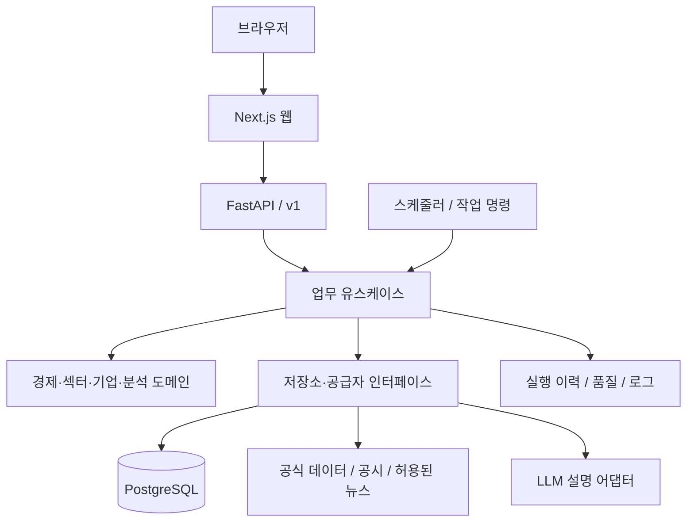

# 02. 시스템 구조와 유지보수

상태: 설계안. 아래 경로와 인터페이스는 구현할 때 사용할 예정 구조입니다.

## 1. 아키텍처 결정

초기에는 **모노레포 + 모듈형 단일 백엔드**로 구성합니다. 웹·API·배치 작업의 실행 단위는 분리하되, 분석 업무 규칙은 하나의 Python 패키지에서 공유합니다.

- Next.js / TypeScript: 화면, 페이지, 사용자 상호작용.
- Tailwind CSS: 디자인 토큰과 화면 스타일.
- Recharts: 차트. 데이터 가공·계산 로직은 차트 컴포넌트 밖에 배치.
- FastAPI / Pydantic: API, 입출력 검증.
- Python / pandas / NumPy: 시계열·재무·점수 계산.
- SciPy / statsmodels / scikit-learn: 필요성이 검증된 분석에 한해 추가.
- PostgreSQL / SQLAlchemy / Alembic: 저장, 조회, 스키마 이력.
- pgvector: 유사 뉴스·이벤트 검색 도입 시 추가. 초기 필수 아님.
- 작업 실행: 짧은 갱신은 Vercel Cron 등으로 보호된 작업 진입점을 호출. 장시간 수집·백필·분석은 별도 작업 환경에서 동일한 Python 유스케이스 실행.
- 작업 큐: 사용자 분석 요청의 대기·재시도·동시 실행이 필요해질 때 Celery 등 도입.

정확한 라이브러리 버전은 구현 착수 시 호환성을 확인하고 lockfile로 고정합니다. 현재 문서는 설치 완료를 의미하지 않습니다.

## 2. 전체 연결



배치 작업이 API를 거쳐 다시 자기 자신을 호출하지 않습니다. API와 배치가 같은 유스케이스를 직접 사용합니다.

## 3. 계획 폴더 구조

```text
eco_swing/
├── README.md
├── docs/
│   ├── 01-product-and-features.md
│   ├── 02-architecture.md
│   ├── 03-data-and-analysis.md
│   ├── 04-roadmap.md
│   ├── decisions/              # 주요 변경 이유: ADR
│   └── runbooks/               # 수집 실패·복구·백업 절차
├── apps/
│   ├── web/
│   │   ├── src/
│   │   │   ├── app/            # 라우트·레이아웃, 조립과 요청 처리
│   │   │   ├── features/       # 기능별 UI·조회 훅·표시 모델
│   │   │   │   ├── dashboard/
│   │   │   │   ├── macro/
│   │   │   │   ├── sectors/
│   │   │   │   ├── stocks/
│   │   │   │   ├── intelligence/
│   │   │   │   ├── research/
│   │   │   │   ├── performance/
│   │   │   │   ├── learn/
│   │   │   │   └── watchlist/
│   │   │   ├── components/ui/  # Button, Table, Dialog 등 공통 표현
│   │   │   ├── components/charts/
│   │   │   ├── lib/api/        # 생성된 API 클라이언트와 오류 변환
│   │   │   ├── lib/format/     # 통화·퍼센트·시각 표시
│   │   │   └── styles/        # 색상·간격·폰트 토큰
│   │   ├── public/
│   │   └── package.json
│   └── backend/
│       ├── src/economy_swing/
│       │   ├── api/            # HTTP 경계: 라우터·인증·DTO
│       │   ├── modules/
│       │   │   ├── catalog/    # 지표·기업·섹터·거래소 마스터
│       │   │   ├── ingestion/  # 수집·정규화·품질 검사
│       │   │   ├── macro/      # 지표 변화와 시장 상태
│       │   │   ├── research/   # 이벤트 스터디·관계 검증
│       │   │   ├── sectors/    # 섹터 분석과 점수
│       │   │   ├── companies/  # 재무·가치·기업 점수
│       │   │   ├── intelligence/ # 뉴스·이벤트·설명
│       │   │   └── tracking/   # 후보 기록·성과·관심 목록
│       │   ├── infrastructure/
│       │   │   ├── db/         # 연결·모델·저장소 구현
│       │   │   ├── providers/  # FRED·ECOS·시장·공시 등 어댑터
│       │   │   ├── llm/        # 공급자 호출·출력 검증
│       │   │   └── observability/
│       │   ├── jobs/           # 실행 명령과 작업 조립
│       │   ├── config/         # 환경 설정·모델 설정 로더
│       │   └── shared/         # 꼭 필요한 식별자·시각·오류 공통형
│       ├── migrations/
│       ├── tests/
│       │   ├── unit/
│       │   ├── integration/
│       │   └── fixtures/
│       └── pyproject.toml
├── contracts/                  # OpenAPI 스냅샷, 생성 TS 타입
├── config/
│   ├── indicators/             # 지표 주기·단위·필수성
│   ├── universes/              # 국가별 분석 대상과 유효 기간
│   ├── scoring/                # 모델별 가중치·정규화·결측 정책
│   └── prompts/                # 설명 템플릿과 버전
├── scripts/                    # 개발·검증·백필 공통 명령
├── tests/e2e/                  # 필수 사용자 흐름
├── infra/                      # 로컬 DB 및 배포 설정
├── .env.example
└── .gitignore
```

전체 빈 폴더를 미리 만들지 않습니다. 해당 단계의 기능이 생길 때 추가하여 사용하지 않는 추상화를 피합니다.

## 4. 모듈 내부의 책임

필요한 모듈에서 아래 구조를 따릅니다. 간단한 조회 기능까지 모든 계층을 억지로 만들지는 않습니다.

| 구성 | 책임 | 두지 않을 것 |
| --- | --- | --- |
| `domain/` | 계산, 조건, 점수 정책, 업무 모델 | HTTP·DB 세션·외부 API 호출 |
| `application/` | 데이터를 모아 도메인을 실행하고 결과 저장 | 공급자별 응답 파싱, UI 표시 |
| `ports.py` | 필요한 데이터·저장·설명 인터페이스 | 구체적인 외부 서비스 구현 |
| API 라우터 | 입력 검증, 권한, 유스케이스 호출, 응답 | 수익률 공식, 가중치 계산 |
| 인프라 어댑터 | DB·API·LLM 실제 접근 | 리서치 판단 정책 |
| 프런트 기능 폴더 | 표시·필터·상호작용·데이터 조회 | 재무비율·수익률·점수 재계산 |

의존 방향은 `API/작업 → application → domain/ports`입니다. 인프라는 ports를 구현하며 domain이 인프라를 가져오지 않습니다. 다른 모듈의 DB 테이블을 임의로 수정하지 않고 공개 유스케이스/조회 인터페이스를 사용합니다.

## 5. 유지보수 규칙

1. **업무 계산의 원본은 한 곳:** 같은 수익률·점수를 프런트, API, 작업에서 따로 구현하지 않음.
2. **기능별로 함께 배치:** 기능 전용 컴포넌트·훅·타입을 해당 feature에 둠. 실제로 공유하는 것만 공통화.
3. **설정과 코드 분리:** 지표 목록, 섹터 대용 지표, 가중치, 신뢰도 기준, 모델 버전을 설정으로 관리.
4. **외부 공급자 교체 가능:** 원본 응답을 정규 모델로 바꾸는 어댑터에서 차이를 흡수.
5. **계약 자동 생성:** FastAPI OpenAPI에서 TypeScript 타입/클라이언트를 생성. 별도 수작업 타입 복제 금지.
6. **스키마 변경은 migration:** 이미 배포한 migration 수정 대신 새 migration 추가.
7. **결과 버전 보존:** 가중치·공식·대상 목록이 바뀌면 모델 버전과 재계산 범위를 기록.
8. **용어 통일:** `sector`, `stock`, `opportunity_score`, `confidence`, `as_of` 등 이름을 계약에서 정의.
9. **예시 데이터 격리:** fixtures와 demo 모드로 분리. 실제 데이터와 같은 순위/성과에 섞지 않음.
10. **정책 변경 이유 보존:** 중요한 결정은 `docs/decisions/`에 배경·선택·대안·영향을 기록.

## 6. API 계획

아래는 목표 인터페이스입니다. 각 단계에서 필요한 항목만 구현합니다.

| 메서드·경로 | 용도 |
| --- | --- |
| `GET /api/v1/dashboard` | 시장별 요약·상위 섹터·품질 상태 |
| `GET /api/v1/macro/indicators` | 지표 목록과 최신 관측치 |
| `GET /api/v1/macro/indicators/{id}/series` | 기간별 시계열 |
| `GET /api/v1/sectors` | 국가별 섹터 순위 |
| `GET /api/v1/sectors/{id}` | 점수 분해·연결 관계 |
| `GET /api/v1/relationships` | 사전 계산한 관계 조회 |
| `GET /api/v1/relationships/{id}` | 정의·버전·결과·이벤트 목록 |
| `GET /api/v1/intelligence/events` | 이벤트와 영향 요약 |
| `GET /api/v1/stocks` | 종목 검색·필터 |
| `GET /api/v1/stocks/{id}` | 기업 개요·점수·근거 |
| `GET /api/v1/stocks/{id}/financials` | 원본 재무·지표·추세·동종 비교 |
| `POST /api/v1/backtests` | 허용된 조건의 분석 작업 요청 |
| `GET /api/v1/jobs/{id}` | 대기·실행·성공·실패 상태 |
| `GET /api/v1/backtests/{id}` | 완료된 분석 결과 |
| `GET/POST /api/v1/watchlist` | 관심 목록 조회·저장 |
| `DELETE /api/v1/watchlist/{id}` | 관심 항목 삭제 |
| `GET /api/v1/recommendations` | 당시 후보 원본 기록 |
| `GET /api/v1/performance` | 시장·기간·모델별 성과 |
| `GET /api/v1/learn/terms` | 버전 관리되는 설명 사전 |
| `GET /health/live`, `GET /health/ready` | 프로세스·핵심 의존성 상태 |

- 날짜·국가·기간·정렬 조건을 검증하고 최대 조회 범위·페이지 크기 제한.
- 식별자는 티커 문자열 대신 내부 ID 사용. 티커는 검색 및 표시 속성.
- 조회 응답에 `as_of`, `generated_at`, `data_mode`, `quality`, 필요 시 `model_version` 포함.
- 오류 형식은 `code`, `message`, `request_id`, `details`로 통일.
- 긴 분석은 요청에서 기다리지 않고 작업 ID와 `202` 응답 후 상태 조회.
- 내부 재수집·재계산 명령은 공개 사용자 API와 분리.
- Next.js 서버가 API를 호출하더라도 역할은 세션·요청 중계까지이며 계산 엔진을 중복 구현하지 않음.

## 7. 수집·배치·복구

```text
공급자 수집
 → 정규화
 → 형식·단위·중복·시각 검사
 → 유효 데이터 저장 / 실패 데이터 격리
 → 변경된 구간의 특징량·관계·점수 계산
 → 설명 생성
 → 스냅샷 발행
 → 성과 추적
```

- 매일 06:00 KST는 희망 실행 시각으로 취급하며, 미국 서머타임·시장 마감·공급 지연을 반영해 실제 준비 상태를 확인.
- 경제지표는 발표 주기와 발표 시각에 맞게 수집. 장중 시세·종가·월간 통계를 같은 갱신 주기로 취급하지 않음.
- 주간: 성과와 관계 상태 점검. 월간: 모델·가중치·품질 검토.
- 재실행해도 중복 저장하지 않는 키와 유니크 제약 사용.
- 작업별 상태·구간·시도 횟수·오류·입력/출력 버전 저장.
- 일시 실패만 제한된 횟수로 지수 백오프 재시도. 영구 오류는 격리 후 원인 표시.
- 동일 작업 중복 실행 잠금, 공급자별 속도 제한, 백필과 일일 작업의 충돌 방지.
- 계산 결과는 새 실행 단위로 저장한 뒤 완료된 묶음만 공개 스냅샷으로 전환.
- 일부 실패 시 최근 성공 결과를 유지하면서 오래됨과 실패 영역 표시. 불완전 결과를 정상 최신으로 덮어쓰지 않음.

## 8. 보안·운영

- 초기 로컬 개인용: loopback에만 연결. 외부 공개 전 인증·권한·HTTPS 적용.
- API 키와 DB 비밀번호는 환경변수/배포 비밀 저장소 사용. 브라우저 번들·Git·로그에 포함 금지.
- `.env.example`에는 변수 이름과 가짜 예시만 기록.
- 읽기·관리·작업 실행 권한 분리. 관심 목록은 사용자 소유권 확인.
- 뉴스 본문은 신뢰하지 않는 입력으로 취급. 본문의 지시로 도구·네트워크·비밀 접근 실행 금지.
- 수집 URL은 공급자별 허용 범위를 제한. 임의 URL 요청과 내부망 접근 차단.
- 외부 데이터 저장·요약·재배포·캐시 정책을 공급자별로 기록.
- 로그에 요청/작업 ID, 공급자, 처리 구간, 지연, 실패 건수를 남김. 개인정보·키·민감 원문은 제거.
- DB 백업과 복원 절차를 문서화하고 실제 복원 확인. RPO/RTO는 배포 환경 결정 시 확정.

## 9. 테스트와 검증

| 범위 | 반드시 검증할 내용 |
| --- | --- |
| 계산 단위 테스트 | 수익률, bp/%p 단위, 벤치마크 차이, 결측, 0·음수 분모 |
| 이벤트 스터디 | 휴장일, 발표 후 진입 시각, 관측 중첩, 미래 데이터 차단 |
| 점수 | 가중치 합, 부호 방향, 정규화, 결측 정책, 버전 재현 |
| 공급자 계약 | 응답 변경, 단위, 시간대, 수정치, 제한·실패 응답 |
| DB 통합 | migration, 중복 수집, 트랜잭션, 스냅샷 전환, 원본 보존 |
| API 계약 | OpenAPI와 클라이언트 일치, 검증·페이지 처리·권한 |
| AI 출력 | 허용된 숫자·근거만 인용, 스키마 실패, 키 누락, 조작 입력 |
| 핵심 E2E | 대시보드 → 지표 → 섹터 → 과거 근거, 이후 기업·저장·성과 |
| 화면 확인 | 모바일, 키보드, 차트 단위, 빈 상태·오류·오래된 데이터 |

외부 API를 매번 호출하는 테스트 대신 고정 fixtures로 회귀 검증하고, 실제 연동 확인은 별도 제한된 점검으로 수행합니다. 단순 스타일 변경에 의미 없는 테스트를 추가하지 않습니다.

## 10. 규모가 커질 때의 확장 조건

- 작업 대기·동시 실행 요구가 생기면 큐/worker 도입.
- 반복 조회의 비용이 확인되면 결과 캐시/집계 뷰 추가. 캐시 키에 기준일·모델 버전 포함.
- 유사 이벤트 검색이 키워드 검색으로 부족할 때만 임베딩·pgvector 도입.
- 수집/분석 부하가 웹 응답을 방해할 때 프로세스·자원 분리 확대.
- 운영·팀 경계가 실제로 분리될 때만 서비스 분리 검토.

초기부터 Redis·벡터 DB·마이크로서비스를 필수로 도입하지 않습니다. 위 확장이 가능하도록 경계만 먼저 유지합니다.

## 11. Vercel 배포 기준

사용자 결정에 따라 배포 목표는 GitHub Pages 대신 **Vercel**로 확정합니다. 개발은 로컬에서 진행하며 실제 배포·외부 서비스 연결은 구현 이후 수행합니다.

| 실행 단위 | 기본 배치 | 역할 |
| --- | --- | --- |
| Next.js 웹 | Vercel, `apps/web` 루트 프로젝트 | 화면·세션·필요한 API 요청 중계 |
| FastAPI API | Vercel, `apps/backend` 루트 프로젝트 | 검증·DB 조회·시간 제한 내 분석 요청 처리 |
| PostgreSQL | 외부 관리형 DB, 공급자 미확정 | 시계열·공시·분석·작업·사용자 데이터 영구 저장 |
| 정기 작업 | 짧은 작업은 Cron 호출, 긴 작업은 별도 실행 환경 | 수집·백필·관계 계산·성과 갱신 |

- 모노레포에서 웹/API를 각각 배포하는 구성을 기본안으로 두고, 배포 프로젝트 사이의 라우팅·인증·미리보기 환경 연결을 구현 단계에서 검증합니다.
- FastAPI는 Vercel의 Python Function으로 실행됩니다. 상시 실행 프로세스나 로컬 디스크를 영구 저장소로 가정하지 않습니다.
- 최대 실행 시간·메모리·번들 크기·Cron 빈도는 실제 선택 요금제와 최신 제한을 확인합니다. 현재 문서에서 비용이나 무제한 실행을 보장하지 않습니다.
- 오래 걸리는 작업은 요청에서 완료를 기다리지 않습니다. 작업 ID 반환 후 실제 작업을 영속적인 큐/작업 실행 환경에 넘기고 상태를 저장합니다. 응답 후 임의의 Python 백그라운드 태스크만 실행하는 방식으로 완료를 보장하지 않습니다.
- DB 연결 수를 제한하고 풀링을 사용합니다. 웹/API/DB 리전, 프리뷰와 운영 DB 분리도 배포 시 확인합니다.
- Cron 진입점은 인증하고 중복 실행 방지·재시도·마지막 성공 상태를 유지합니다. 정각 실행이나 자동 재시도를 가정하지 않습니다.
- Next.js의 사용자별 동적 응답과 API 비밀은 서버 측에서 처리합니다. 정적 JSON만 제공해야 한다는 제약은 채택하지 않습니다.

확인한 공식 문서: [FastAPI 배포](https://vercel.com/docs/frameworks/backend/fastapi), [함수 제한](https://vercel.com/docs/functions/limitations), [스토리지](https://vercel.com/docs/storage), [Cron 사용 조건](https://vercel.com/docs/cron-jobs/usage-and-pricing). 지원 범위와 수치는 실제 배포 시 재확인합니다.
